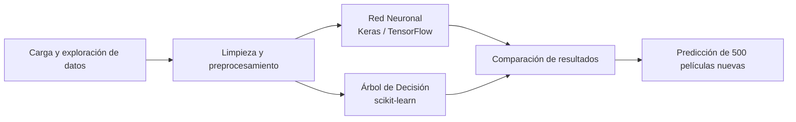

# 🎬 Clasificación de películas con Árboles de Decisión y Redes Neuronales


[](https://colab.research.google.com/github/sanherrero/proyecto-ia-2026/blob/main/proyecto.ipynb)

Proyecto de **Aprendizaje Automático** que clasifica películas en tres categorías de calidad (**Mala**, **Buena** y **Muy buena**) y compara dos enfoques distintos: un **Árbol de Decisión** y una **Red Neuronal Artificial (RNA)**.

👥 **Autores:** Lautaro Coñoen y Santiago Herrero

---

## 📊 Resultados

| Modelo | Librería | Precisión (accuracy) | Evaluado sobre |
|---|---|:---:|---|
| 🌳 Árbol de Decisión | scikit-learn | **70%** | Conjunto de test (holdout) |
| 🧠 Red Neuronal Artificial | Keras / TensorFlow | **71%** | Conjunto de validación |

Ambos modelos obtuvieron resultados muy similares.

---

## 🗂️ Datos

| | Archivo | Filas |
|---|---|:---:|
| Entrenamiento | `movies_train.csv` | 12.500 |
| Prueba | `movies_test_actualizado.csv` | 500 |

El dataset tiene **25 columnas** con información técnica, financiera e histórica de las películas, de sus actores principales (`popularity_p1`, `number_movies_p1`, etc.) y del director.

**Distribución de las clases** (el conjunto está desbalanceado):

| Clase | Proporción |
|---|:---:|
| Buena | 46,15% |
| Mala | 38,46% |
| Muy buena | ~15,38% |

---

## 🔄 Flujo del proyecto



---

## 🧹 Procesamiento y limpieza de datos

- **Columnas eliminadas:** identificadores y textos que no aportan al entrenamiento (`movieId`, `title` y nombres de actores y directores).
- **Valores nulos:**
  - Duración (`runtime`) y popularidad del director → se completan con el promedio.
  - Ingresos (`revenue`) → se completan con `0`.
  - Géneros faltantes → `'Unknown'`.
- **Atributos categóricos:**
  - `belong_to_collection` → binario (0 o 1).
  - Clase objetivo (`class`) → `Mala = 0`, `Buena = 1`, `Muy buena = 2`.
  - `genre` → One-Hot Encoding (una columna binaria por género).

---

## 🧠 Modelo 1: Red Neuronal Artificial (Keras / TensorFlow)

Los datos numéricos se estandarizan con `MinMaxScaler` y se entrena una red secuencial:

| Capa | Neuronas | Detalle |
|---|:---:|---|
| Entrada | 128 | Activación ReLU |
| Oculta 1 | 64 | Dropout 30% |
| Oculta 2 | 32 | Dropout 30% |
| Salida | 3 | Softmax (una probabilidad por categoría) |

Técnicas aplicadas:

- **Pesos de clase balanceados**, para compensar el desequilibrio de la categoría "Muy buena".
- **Dropout (30%)**, para evitar el sobreajuste.
- **Early Stopping**, que detiene el entrenamiento cuando el error de validación deja de mejorar.

**Resultado:** 71% de precisión global sobre el conjunto de validación.

---

## 🌳 Modelo 2: Árbol de Decisión (scikit-learn)

Se entrena un `DecisionTreeClassifier` y se optimizan sus hiperparámetros paso a paso, con validación cruzada simulada:

| Hiperparámetro | Qué se probó | Valor óptimo |
|---|---|:---:|
| `max_depth` | Profundidades de 1 a 50 | **8** (70% de precisión) |
| `criterion` | Gini vs. entropía | **Gini** |
| `min_samples_split` | Tamaño mínimo de división | **50** muestras por nodo |

**Resultado:** 70% de precisión global sobre el conjunto de test (holdout).

Además, el modelo permite ver la **importancia de las variables** e identificar las 10 características que más influyen en el éxito de una película (por ejemplo, presupuesto, ingresos y popularidad).

---

## 📤 Predicción final

Ambos modelos, ya optimizados, generan predicciones para las **500 películas nuevas** del conjunto de test. Las predicciones se convierten de nuevo a etiquetas de texto (`Mala`, `Buena`, `Muy buena`) y se guardan como columnas adicionales en el DataFrame de salida.

---

## ▶️ Cómo ejecutarlo

1. Hacé clic en el botón **Open In Colab** de arriba.
2. Si el notebook pide los datos, subí `movies_train.csv` y `movies_test_actualizado.csv` desde el panel de archivos de Colab (ambos están en este repositorio).
3. Ejecutá todas las celdas desde **Entorno de ejecución → Ejecutar todo**.

---

## 📁 Estructura del repositorio

```
proyecto-ia-2026/
├── proyecto.ipynb                 # Notebook con todo el desarrollo
├── movies_train.csv               # Datos de entrenamiento (12.500 filas)
├── movies_test_actualizado.csv    # Datos de prueba (500 filas)
└── README.md
```

## 🛠️ Tecnologías

Python · pandas · scikit-learn · Keras / TensorFlow · Google Colab
